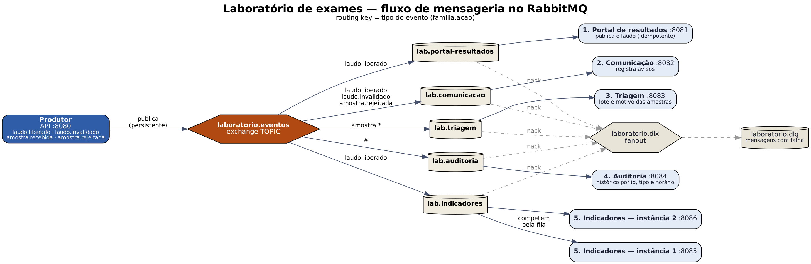

# 🧪 Laboratório de Exames — Mensageria com RabbitMQ

**Disciplina:** Sistemas Distribuídos e Cloud Computing — Tema 06  
**Tecnologias:** Java 21 · Spring Boot 3.5 · Spring AMQP · RabbitMQ 3

Um laboratório didático acompanha laudos e a triagem de amostras. Uma **aplicação produtora** registra os fatos do domínio e publica eventos no RabbitMQ. **Cinco responsabilidades de consumo** reagem a eles de forma independente, cada uma no seu próprio processo. Todos os dados são fictícios.

## Integrantes

- Arthur Viceles Vida
- Leonardo Vieira Alvim
- Gabriel Gonçalves
- Mauro Roque
- Lucas Adriano

## Arquitetura



| Aplicação | Perfil Spring | Porta | Fila | Efeito verificável |
|---|---|---|---|---|
| Produtor | `produtor` | 8080 | — | `GET /eventos` (publicações) e `GET /filas` (situação das filas) |
| 1. Portal de resultados | `portal` | 8081 | `lab.portal-resultados` | `GET /portal/laudos`, `GET /portal/resumo` |
| 2. Comunicação | `comunicacao` | 8082 | `lab.comunicacao` | `GET /comunicacao/avisos` |
| 3. Triagem | `triagem` | 8083 | `lab.triagem` | `GET /triagem/registros` |
| 4. Auditoria | `auditoria` | 8084 | `lab.auditoria` | `GET /auditoria?eventoId=&tipo=&de=&ate=` |
| 5. Indicadores (2 instâncias) | `indicadores` | 8085 e 8086 | `lab.indicadores` | `GET /indicadores` |

- **Um jar, processos separados.** O mesmo `target/laboratorio.jar` sobe qualquer papel conforme o perfil. Cada papel roda em seu próprio processo e pode ser **iniciado e parado de forma independente**.
- **Efeitos gravados em disco.** Cada consumidor grava seu efeito em `dados/*.jsonl` (um JSON por linha) e expõe uma consulta HTTP.
- **Durabilidade.** Filas duráveis + mensagens persistentes: se um consumidor estiver desligado, os eventos dele ficam esperando na fila.

## Contrato JSON dos eventos

```json
{
  "eventoId": "3f6a9c1e-8b2d-4e57-9a10-6c4d2b7e9f01",
  "tipo": "laudo.liberado",
  "ocorridoEm": "2026-11-21T10:15:30.481227-03:00",
  "origem": "produtor-laboratorio",
  "dados": {
    "laudoId": "LAU-1001",
    "exame": "HEMOGRAMA",
    "pacienteCodigo": "PAC-0041"
  }
}
```

| Campo | Significado |
|---|---|
| `eventoId` | Identificador único (UUID). Na republicação de teste, o **mesmo** id é reenviado. Também vai no `message_id` da mensagem AMQP. |
| `tipo` | Fato ocorrido, no formato `familia.acao`. **É a routing key.** |
| `ocorridoEm` | Momento da ocorrência (ISO-8601 com fuso). |
| `origem` | Quem publicou. |
| `dados` | Dados para os efeitos. Laudo: `laudoId`, `exame`, `pacienteCodigo` (+ `motivo` na invalidação). Amostra: `amostraId`, `lote`, `exame` (+ `motivo` na rejeição). |

<details><summary>Exemplos dos outros três eventos</summary>

```json
{ "eventoId": "…", "tipo": "laudo.invalidado", "ocorridoEm": "…", "origem": "produtor-laboratorio",
  "dados": { "laudoId": "LAU-1002", "exame": "TSH", "pacienteCodigo": "PAC-0042", "motivo": "Amostra trocada na bancada" } }

{ "eventoId": "…", "tipo": "amostra.recebida", "ocorridoEm": "…", "origem": "produtor-laboratorio",
  "dados": { "amostraId": "AMO-2001", "exame": "GLICEMIA", "lote": "LOTE-2026-11-21-A" } }

{ "eventoId": "…", "tipo": "amostra.rejeitada", "ocorridoEm": "…", "origem": "produtor-laboratorio",
  "dados": { "amostraId": "AMO-2002", "exame": "CREATININA", "lote": "LOTE-2026-11-21-A", "motivo": "Amostra hemolisada" } }
```
</details>

## Configuração do RabbitMQ

A topologia é declarada no código ([`RabbitConfig.java`](src/main/java/br/edu/unifio/laboratorio/config/RabbitConfig.java)) por **todas** as aplicações ao conectar. A declaração é idempotente, então qualquer broker vazio fica configurado do mesmo jeito. As filas também existem mesmo que um consumidor ainda não tenha sido iniciado.

| Elemento | Tipo | Configuração |
|---|---|---|
| `laboratorio.eventos` | exchange **topic** | durável |
| `lab.portal-resultados` | fila durável | binding `laudo.liberado` |
| `lab.comunicacao` | fila durável | bindings `laudo.liberado`, `laudo.invalidado`, `amostra.rejeitada` |
| `lab.triagem` | fila durável | binding `amostra.*` |
| `lab.auditoria` | fila durável | binding `#` |
| `lab.indicadores` | fila durável | binding `laudo.liberado`, **uma fila só para as 2 instâncias** |
| `laboratorio.dlx` → `laboratorio.dlq` | fanout + fila | recebe mensagens rejeitadas (`nack`) por qualquer fila |

### Matriz de roteamento (evento × consumidor)

| Evento (routing key) | Portal | Comunicação | Triagem | Auditoria | Indicadores |
|---|:-:|:-:|:-:|:-:|:-:|
| `laudo.liberado` | ✅ | ✅ | — | ✅ | ✅ (1 instância) |
| `laudo.invalidado` | — | ✅ | — | ✅ | — |
| `amostra.recebida` | — | — | ✅ | ✅ | — |
| `amostra.rejeitada` | — | ✅ | ✅ | ✅ | — |
| *novo:* `amostra.descartada` | — | — | ✅ (`amostra.*`) | ✅ (`#`) | — |
| *novo:* `laudo.revisado` | — | — | — | ✅ (`#`) | — |

### Por que exchange *topic*

| Necessidade | Direct | Fanout | **Topic** (escolhida) |
|---|---|---|---|
| **Seleção por evento** (Portal só quer `laudo.liberado`) | ✅ routing key exata | ❌ entrega tudo a todos | ✅ chave exata `laudo.liberado` |
| **Acompanhar uma família** (Triagem quer todo `amostra.*`, inclusive tipos novos) | ❌ sem curinga: cada tipo novo exige um binding novo | ❌ não filtra | ✅ `amostra.*` |
| **Recebimento abrangente** (Auditoria quer tudo) | ⚠️ um binding por tipo, e esquece os novos | ✅ | ✅ `#` |

- **Direct** obrigaria a manter a lista de tipos à mão. Um evento novo da família "amostra" não chegaria à Triagem.
- **Fanout** não diferencia eventos: Portal e Indicadores receberiam amostras e teriam que descartar.
- **Topic** atende as três necessidades com uma exchange só.

### Quando aparece um evento novo

- **Evento novo de uma família acompanhada,** por exemplo `amostra.descartada`: chega **sem mudar nada** na Triagem (`amostra.*`) e na Auditoria (`#`). A Triagem registra a situação genérica ("descartada") com lote e motivo.
- **Evento que não atende regra específica de ninguém,** por exemplo `laudo.revisado`: só a **Auditoria** recebe, pelo `#`.
- **Se nem a Auditoria existisse,** a mensagem não casaria com nenhuma fila. Como o produtor publica com `mandatory=true`, o broker devolveria a mensagem e o produtor registraria o aviso no log.

Os dois casos podem ser testados com `POST /eventos/livre`.

## Processamento e confirmação (ACK)

- **ACK manual** (`acknowledge-mode=manual`): o consumidor grava o efeito, força a gravação no disco (`fsync`) e **só depois** envia `basicAck`. Nesse momento o RabbitMQ apaga a mensagem.
- **Se o processamento falhar,** o consumidor envia `basicNack` sem reenfileirar, e a mensagem vai para a `laboratorio.dlq`, sem loop infinito.
- **Se o processo cair antes do ACK,** a mensagem volta para a fila e é reentregue (*at-least-once*). A idempotência garante que o efeito não se repita.
- **`prefetch=1`:** cada consumidor recebe uma mensagem por vez. Nas 2 instâncias de Indicadores, quem está livre pega a próxima.
- **No produtor,** as *publisher confirms* fazem o broker confirmar o recebimento de cada evento (aparece no log do produtor).

### Duplicidade (idempotência)

- **Portal, Comunicação, Triagem e Indicadores:** antes de gravar, verificam se o `eventoId` já está no registro. Se estiver, **não repetem o efeito**, mas confirmam (ACK) a mensagem.
- **Portal:** registra a repetição em `portal-duplicatas-ignoradas.jsonl` como evidência.
- **Auditoria:** registra **todas** as entregas, marcando `"duplicado": true` na repetida. O histórico deve mostrar tudo o que chegou.
- **Indicadores:** a verificação e a gravação ficam sob uma **trava de arquivo entre processos** (`FileLock`), então nenhuma das duas instâncias conta o mesmo evento duas vezes.

## Como executar

### No GitHub Codespaces (recomendado)

O `.devcontainer` instala Java 21, Maven e RabbitMQ e cria o usuário `lab` / `lab123`.

1. **Code → Codespaces → Create codespace on main** e aguarde a criação.
2. No terminal:

```bash
scripts/iniciar-todos.sh     # compila e sobe produtor + 5 consumidores (Indicadores com 2 instâncias)
scripts/status.sh            # aplicações rodando e situação das filas
```

O painel do RabbitMQ fica na porta **15672** (aba *Ports* do Codespaces), com usuário `lab` e senha `lab123`.

### Fora do Codespaces

Pré-requisitos: Java 21, Docker, `curl` e `jq`.

```bash
docker compose up -d         # RabbitMQ com painel (lab / lab123)
scripts/iniciar-todos.sh
```

### No Windows (sem Docker)

Pré-requisitos: Java 21, Erlang e RabbitMQ instalados (o RabbitMQ roda como serviço do Windows). Habilite o painel uma vez, no *RabbitMQ Command Prompt (sbin dir)*:

```
rabbitmq-plugins enable rabbitmq_management
```

Depois reinicie o serviço do RabbitMQ. O painel fica em http://localhost:15672 (usuário `guest`, senha `guest`).

No PowerShell, na pasta do projeto:

```
.\mvnw.cmd -DskipTests package
powershell -ExecutionPolicy Bypass -File .\windows\lab.ps1 ligar
```

O `lab.ps1` sobe as 7 aplicações em segundo plano já usando o usuário `guest`. Para derrubar e religar uma delas:

```
powershell -ExecutionPolicy Bypass -File .\windows\lab.ps1 desligar comunicacao
powershell -ExecutionPolicy Bypass -File .\windows\lab.ps1 ligar comunicacao
powershell -ExecutionPolicy Bypass -File .\windows\lab.ps1 desligar     # todas
```

Os comandos de cada teste (envio de eventos, carga, interrupção e idempotência) estão na pasta [`testes/`](testes/).

### Iniciar e parar cada aplicação

```bash
scripts/iniciar.sh comunicacao     # produtor | portal | comunicacao | triagem | auditoria | indicadores-1 | indicadores-2
scripts/parar.sh comunicacao       # ou: scripts/parar.sh todos
scripts/limpar.sh                  # para tudo, apaga dados/ e logs/ e esvazia as filas
```

Os logs de cada aplicação ficam em `logs/<nome>.log`. Por exemplo, `tail -f logs/indicadores-1.log` mostra qual instância processou cada evento.

## Disparando os eventos

```bash
curl -X POST localhost:8080/eventos/laudo-liberado
curl -X POST localhost:8080/eventos/laudo-invalidado
curl -X POST localhost:8080/eventos/amostra-recebida
curl -X POST localhost:8080/eventos/amostra-rejeitada

# com dados escolhidos (todos os campos são opcionais)
curl -X POST localhost:8080/eventos/amostra-rejeitada -H "Content-Type: application/json" \
     -d '{"amostraId":"AMO-3001","lote":"LOTE-B","motivo":"Volume insuficiente"}'

# sequência de laudos liberados distintos (demonstração das 2 instâncias)
curl -X POST "localhost:8080/eventos/lote/laudos-liberados?quantidade=10"

# evento novo (pergunta "e se surgir um tipo novo?")
curl -X POST localhost:8080/eventos/livre -H "Content-Type: application/json" \
     -d '{"tipo":"amostra.descartada","dados":{"amostraId":"AMO-9001","lote":"LOTE-B","motivo":"Prazo vencido"}}'

# republicar um evento com o MESMO eventoId (teste de duplicidade)
curl -X POST localhost:8080/eventos/<eventoId>/republicar
```

## Reproduzindo os testes

O script abaixo sobe tudo do zero e confere automaticamente o roteamento dos 4 eventos (e dos eventos novos), o trabalho concorrente, a interrupção e recuperação, e a duplicidade:

```bash
scripts/testar.sh
```

Ele termina com `Resultado: N OK, 0 falha(s)`. O passo a passo manual da apresentação está em [`docs/roteiro-apresentacao.md`](docs/roteiro-apresentacao.md).

Testes de unidade (contrato JSON e idempotência, sem precisar do broker):

```bash
./mvnw test
```

## Principais decisões técnicas

1. **Exchange topic com routing key `familia.acao`.** Cobre seleção por evento, família e recebimento total com uma exchange só.
2. **Uma fila por responsabilidade.** Cada consumidor tem sua cópia do evento e seu ritmo, e um consumidor parado não atrapalha os outros.
3. **Fila única para as 2 instâncias de Indicadores** (*competing consumers*). O RabbitMQ entrega cada mensagem a uma só instância.
4. **ACK manual após o efeito gravado, nack para DLQ.** Uma mensagem nunca é perdida por um erro no meio do processamento.
5. **Idempotência por `eventoId`.** A entrega é *at-least-once*, e o efeito é *exactly-once* na prática.
6. **Efeitos em JSON Lines.** São simples de verificar (API ou `cat dados/...`), sobrevivem ao reinício e a trava de arquivo funciona entre processos.
7. **Topologia declarada no código por todas as aplicações.** O ambiente fica reproduzível sem passos manuais no broker.
